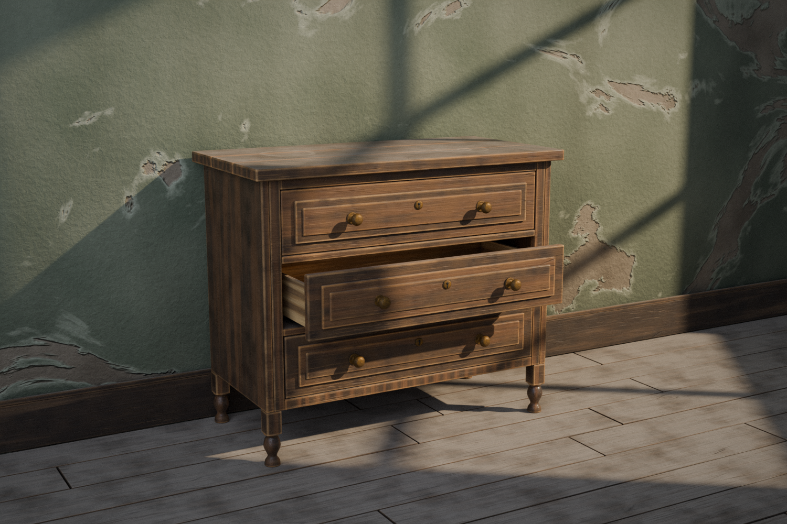

# aged-cabinet

年季の入った木製チェスト(引き出し3段)を Blender の Python API (`bpy`) だけで生成・レンダリングする。
外部テクスチャは使わず、素材はすべてプロシージャル。



## 実行

```fish
uv venv -p 3.13 .venv
uv pip install -p .venv/bin/python bpy numpy pillow
.venv/bin/python build.py                 # 本番 (1500x1000, CPU Cycles, 数十分)
env PREVIEW=1 .venv/bin/python build.py   # 800x534 プレビュー
env QUICK=1 PREVIEW=1 .venv/bin/python build.py   # 480x320 確認用
env VIEW=close PREVIEW=1 .venv/bin/python build.py   # 質感確認の接写 (VIEW=top も可)
```

その他の環境変数: `OUT_DIR`(出力先), `SUN`(太陽の強さ), `WIN_DX` / `WIN_DY`(窓の影の位置), `EXPOSURE`。
出力: `render.png` と `aged_cabinet.blend`(Blender で開いて調整できる)。

## 経年表現

| 要素 | 手法 |
| --- | --- |
| 木目 | Wave(Bands)+歪み、木目方向に引き伸ばしたノイズの筋・導管 |
| エッジの摩耗 | AO(Inside)で凸エッジを検出し、ニスが剥げて素地が覗く |
| 隙間・凹部の汚れ | AO で暗部を検出して黒ずみ |
| ニスのひび割れ・擦り傷 | 木目方向に引き伸ばした Voronoi(Distance to Edge)/ 方向違いのノイズ線 → 色と Bump |
| 天板の埃 | 法線の上向き成分×ノイズで艶消し化 |
| 水の輪染み | 世界座標で円環を生成し、白濁と艶の変化を加える |
| 真鍮金具 | 凹部に緑青、全体にくすみ、粗さのムラ |
| 部材の個体差 | Object Info の Random で木目をずらし、引き出し・天板板に微小な傾きやズレ |
| 壁・床 | 剥がれた塗装の漆喰壁、隙間のある床板 |

窓の形の光は、カメラ・間接光から不可視にしたオクルーダ(影だけ落とす板)で作っている。
